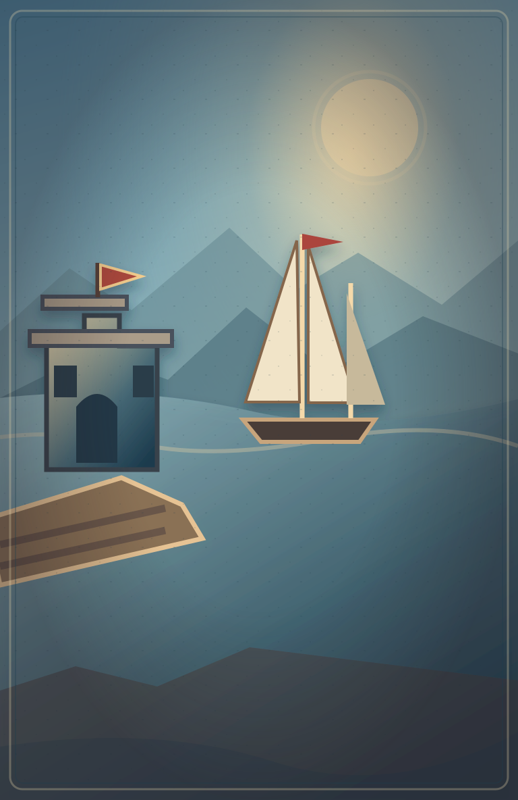
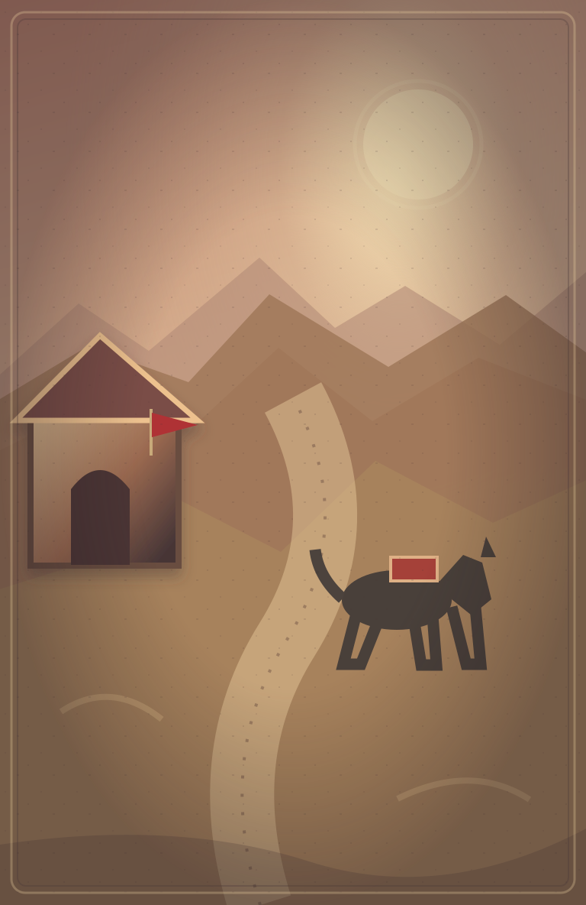
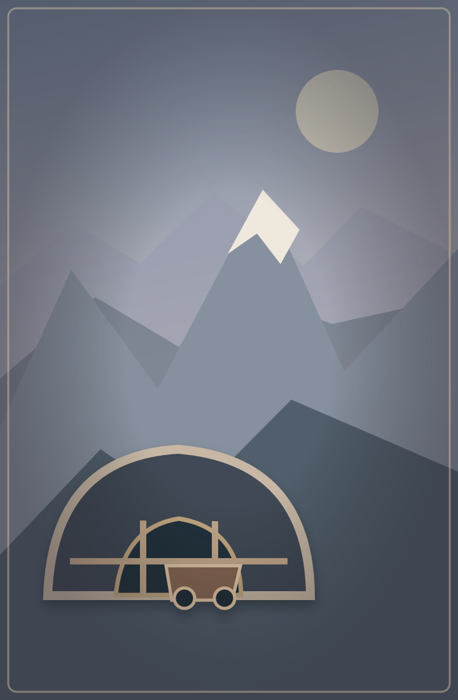
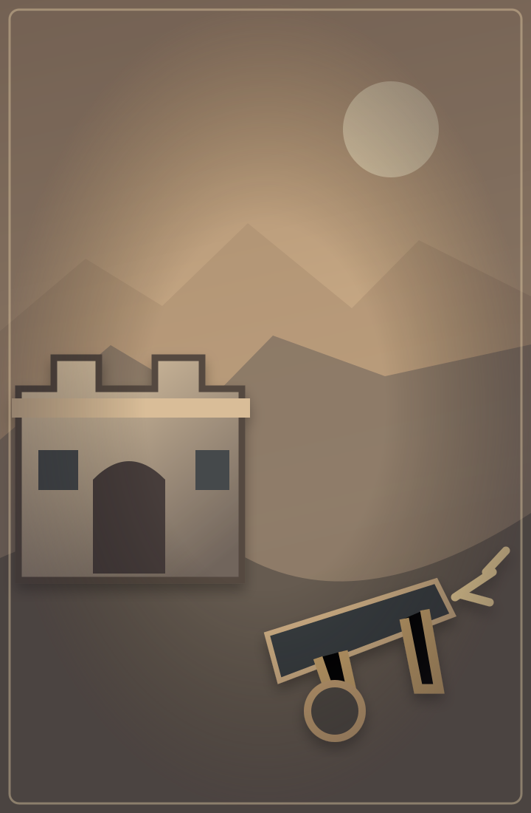
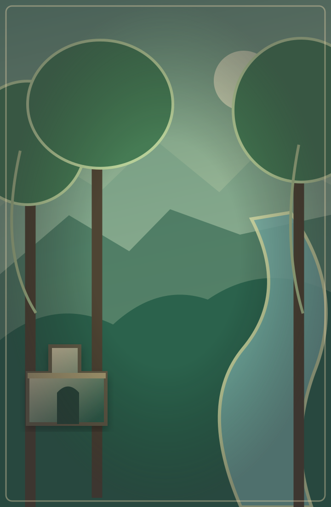
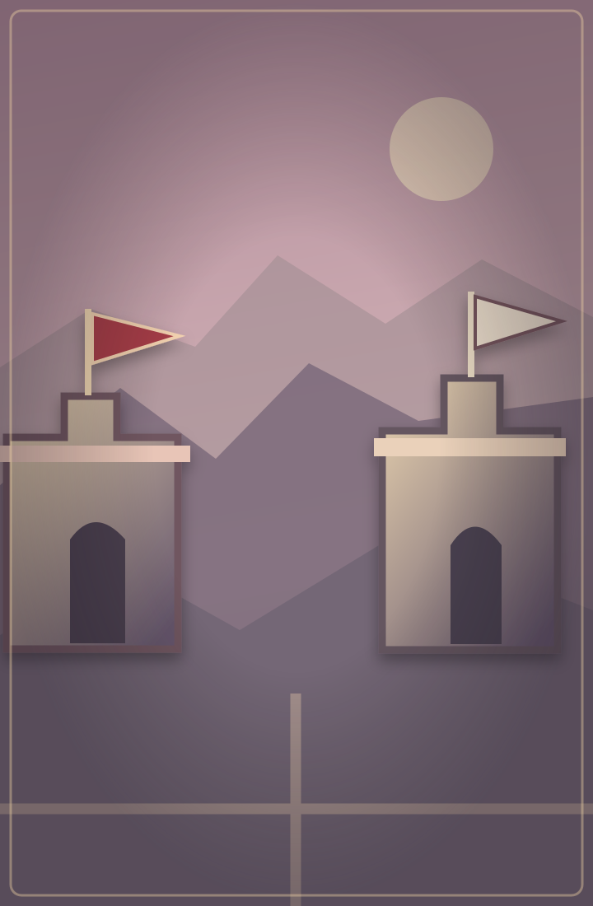
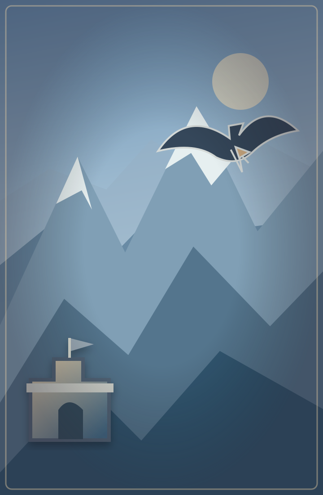
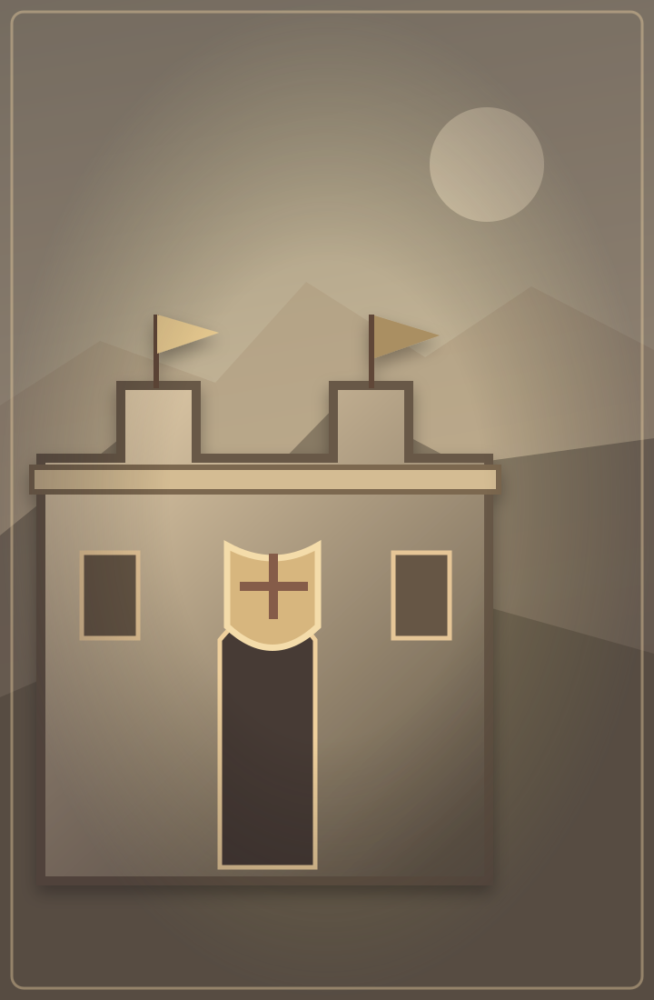
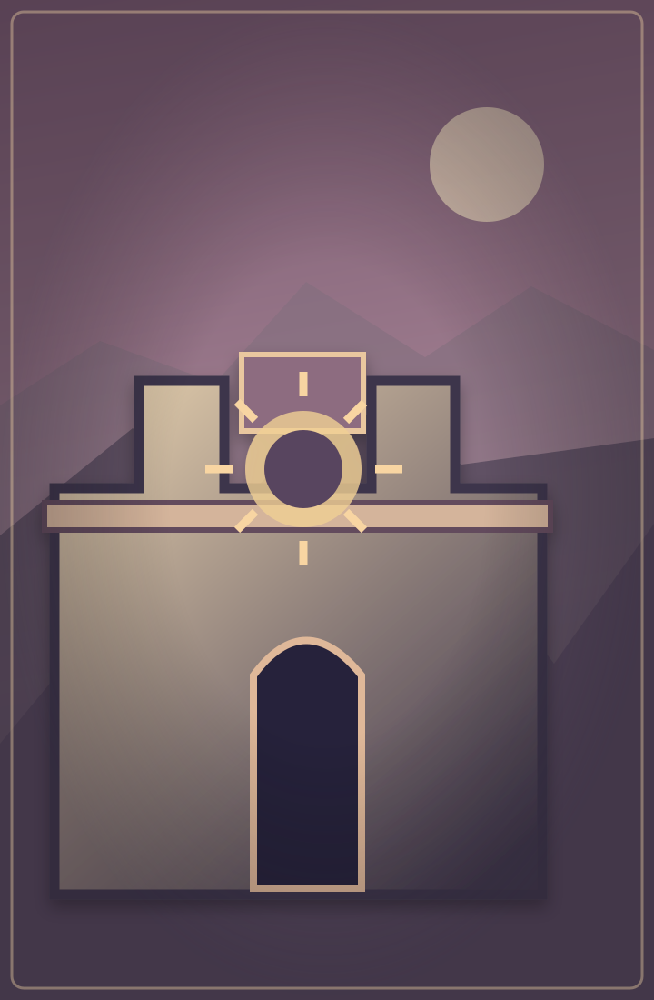

# Galería de escenarios — Decreto Real

Vista comparativa de los **ocho territorios de campaña y el escenario central**. Las imágenes son fondos vectoriales de primera iteración, sin texto, marcadores ni estrellas incrustados: los elementos de juego se colocan en React.

<table>
<tr>
<td align="center"> <b>1 · Baltasar de Fierro</b> Puerto del Callao</td>
<td align="center"> <b>2 · Leandro Valcázar</b> Caminos escarlatas</td>
<td align="center"> <b>3 · Octavio Argento</b> La plata enterrada</td>
</tr>
<tr>
<td align="center"> <b>4 · Jerónimo Arrellano</b> Bastión del Trueno</td>
<td align="center"> <b>5 · Nayisa de Sombras</b> Frontera oriental</td>
<td align="center"> <b>6 · Isabela Valdierra</b> Ciudad de estandartes</td>
</tr>
<tr>
<td align="center"> <b>7 · Aukan del Cóndor</b> Fortaleza de las cumbres</td>
<td align="center"> <b>8 · Gonzalo de Montes</b> Casa del Juramento</td>
<td align="center"> <b>Final · Sigumán</b> Casa del Sello</td>
</tr>
</table>

## Dirección de arte aprobada como base

- **Relación de aspecto:** 720 × 1100, vertical, para las pantallas móviles sin desplazamiento.
- **Separación visual:** capa de paisaje distinta para cada región; el camino de cuatro nodos, estrellas y botones no forman parte del archivo de imagen.
- **Paletas independientes:** azul marítimo, terracota, gris plata, bronce, verde profundo, granate, celeste de montaña, ocre ceremonial y púrpura del final.
- **Accesibilidad:** contrastes y textos controlados por componentes HTML; los territorios se distinguen también por su monumento, no solo por color.
- **Reutilización:** el mismo SVG se utiliza como fondo del mapa regional y como escena temática del duelo de campaña, manteniendo separado el duelo libre.
- **Pendiente:** validación visual en teléfono físico y sustitución progresiva por ilustraciones de calidad final conservando nombres y dimensiones de los recursos.

[Ver el PR de implementación](https://github.com/Afelex/Decreto-Real/pull/57)
